# 🤖 AI-Powered RTL Code Understanding & Bug Detection Platform

> A Python CLI platform for compiling, simulating, and AI-analyzing Verilog/SystemVerilog RTL designs — with automatic clock/reset detection, VCD waveform output, and a pluggable AI engine for future bug detection and code understanding.

---

## 📌 Table of Contents

- [Overview](#-overview)
- [How It Works](#-how-it-works)
- [System Architecture](#-system-architecture)
- [Full System Flowchart](#-full-system-flowchart)
- [Tech Stack](#-tech-stack)
- [Project Structure](#-project-structure)
- [CLI Reference](#-cli-reference)
- [Configuration Reference](#-configuration-reference)
- [WebSocket & API Protocol](#-websocket--api-protocol)
- [Setup & Installation](#-setup--installation)
- [Running the Platform](#-running-the-platform)
- [Example Modules](#-example-modules)
- [Simulation Modes](#-simulation-modes)
- [C++ Testbench Generation](#-c-testbench-generation)
- [VCD Waveform Output](#-vcd-waveform-output)
- [AI Provider Configuration](#-ai-provider-configuration)
- [Development & Testing](#-development--testing)
- [Development Timeline](#-development-timeline)

---

## 🧠 Overview

The **AI-Powered RTL Code Understanding & Bug Detection Platform** bridges hardware description language (HDL) design with AI-assisted verification. It provides:

1. **RTL Compilation** — Compiles Verilog/SystemVerilog designs via Verilator.
2. **RTL Simulation** — Runs gate-level simulation with auto-generated or custom C++ testbenches.
3. **VCD Waveform Output** — Produces standard Value Change Dump files for waveform viewing.
4. **Clock & Reset Detection** — Parses RTL source to auto-identify clock and reset ports.
5. **Mock Mode** — Lightweight synthetic simulation for CI/CD pipelines without Verilator installed.
6. **AI Integration** — Pluggable AI backend (OpenAI GPT-4 / HuggingFace) for code explanation, bug detection, and waveform anomaly analysis.

| Mode | Requires Verilator? | Executes RTL? | VCD Output |
|------|-------------------|--------------|------------|
| **Verilator** | ✅ Yes | ✅ Yes | Real waveform |
| **Mock** | ❌ No | ❌ No | Synthetic VCD |

---

## ⚙️ How It Works

The platform operates as an automated **multi-stage verification pipeline**:

1. **CLI Invocation** — User runs `rtlverify compile` or `rtlverify simulate` with RTL file paths and top module name.
2. **Config Loading** — `ConfigManager` reads `configs/default_config.yaml` using dot-notation key access.
3. **Engine Selection** — Based on config or `--mock` flag, selects Verilator or Mock engine.
4. **Verilator Availability Check** — `shutil.which()` probes PATH for `verilator`; automatically falls back to Mock if absent.
5. **Clock/Reset Detection** — Regex-parses the RTL file, stripping comments, to find all `input` ports matching `clk/clock` or `rst/reset` patterns.
6. **Testbench Generation** — Generates a C++ Verilator testbench (`tb_<top>.cpp`) with proper clock toggle, reset assertion/deassertion, and VCD trace hooks.
7. **Compilation** — Runs `verilator --cc <rtl> --exe <tb> --trace -Mdir obj_dir`.
8. **Make Build** — Runs `make -C obj_dir -f V<top>.mk` to compile the generated C++ harness.
9. **Simulation Run** — Executes the compiled binary, which writes a `.vcd` waveform file.
10. **Result Reporting** — Rich terminal table shows engine mode, VCD path, stdout/stderr logs.

---

## 🏗️ System Architecture

```
┌──────────────────────────────────────────────────────────────────┐
│                        USER (Terminal)                           │
│                                                                  │
│   rtlverify compile  examples/counter/counter.v --top counter    │
│   rtlverify simulate examples/counter/counter.v --top counter    │
│   rtlverify simulate design.v --top mymod --mock                 │
└───────────────────────────┬──────────────────────────────────────┘
                            │
                     Typer CLI (main.py)
                            │
              ┌─────────────▼────────────┐
              │      ConfigManager       │
              │  configs/default_config  │
              │  .yaml  (YAML loader +   │
              │   dot-notation access)   │
              └─────────────┬────────────┘
                            │
              ┌─────────────▼────────────┐
              │     SimulationEngine     │
              │                          │
              │  ┌──────────────────┐    │
              │  │ detect_clk_rst() │    │
              │  │ (Regex RTL parse)│    │
              │  └────────┬─────────┘    │
              │           │              │
              │  ┌────────▼─────────┐    │
              │  │generate_cpp_tb() │    │
              │  │ (Template engine)│    │
              │  └────────┬─────────┘    │
              │           │              │
              │  ┌────────▼─────────┐    │    ┌──────────────┐
              │  │    Verilator     │────┼───▶│  .vcd file   │
              │  │  compile + make  │    │    │  (waveform)  │
              │  │  + run binary    │    │    └──────────────┘
              │  └──────────────────┘    │
              │           OR             │    ┌──────────────┐
              │  ┌──────────────────┐    │    │  Mock .vcd   │
              │  │   Mock Engine    │────┼───▶│  (synthetic) │
              │  │ (synthetic VCD)  │    │    └──────────────┘
              │  └──────────────────┘    │
              └──────────────────────────┘
                            │
              ┌─────────────▼────────────┐
              │   Rich Console Output    │
              │   (Panels + Tables)      │
              └──────────────────────────┘
```

---

## 🔀 Full System Flowchart

```mermaid
flowchart TD
    A([👤 User runs rtlverify CLI]) --> B{Which command?}

    B -- compile --> C[Parse RTL file paths + top module]
    B -- simulate --> D[Parse RTL paths + top + max-time + mock flag]

    C --> E[Load configs/default_config.yaml]
    D --> E

    E --> F[Instantiate SimulationEngine]
    F --> G{--mock flag or engine=mock in config?}

    G -- Yes --> MOCK[Run Mock Simulation Engine]
    G -- No --> H{Verilator found in PATH?}

    H -- No --> I[⚠️ Log warning: Verilator not found]
    I --> MOCK

    H -- Yes --> J{Custom testbench provided via --tb?}

    J -- Yes --> K[Copy custom .cpp testbench to sim_build/]
    J -- No --> L[detect_clk_rst: Parse RTL source file]

    L --> M[Strip comments via regex]
    M --> N[Find all input ports]
    N --> O{Match clk / clock pattern?}
    O -- Yes --> P[Add to clocks list]
    O -- No --> Q{Match rst / reset pattern?}
    Q -- Yes --> R[Determine active-high or active-low]
    R --> S[Add to resets list]
    Q -- No --> T[Skip port]
    P --> U[generate_cpp_tb with template]
    S --> U
    T --> U

    U --> V[Fill VERILATOR_TB_TEMPLATE]
    V --> W[Write tb_topmodule.cpp to sim_build/]

    K --> X[Run Verilator Compilation]
    W --> X

    X --> Y["verilator --cc rtl.v --exe tb.cpp --trace -Mdir obj_dir"]
    Y --> Z{Compilation success?}
    Z -- No --> ERR1([❌ Print stderr, exit 1])
    Z -- Yes --> AA["make -C obj_dir -f Vtop.mk"]

    AA --> AB{Make build success?}
    AB -- No --> ERR2([❌ Print make error, exit 1])
    AB -- Yes --> AC[Run simulation binary]

    AC --> AD[Binary writes waveform.vcd to sim_build/]
    AD --> AE[Capture stdout/stderr logs]
    AE --> AF[Return result dict: success=True, vcd_path, stage]

    MOCK --> AG[Generate synthetic VCD header]
    AG --> AH[Write mock clock transitions and counter values]
    AH --> AI[Write MOCK simulation log]
    AI --> AF

    AF --> AJ{Command was compile?}
    AJ -- Yes --> AK[Show Rich Panel: Compilation successful]
    AJ -- No --> AL[Show Rich Table: Engine mode + VCD path]
    AL --> AM[Show Rich Panel: Simulation log]
    AK --> AN([✅ Done])
    AM --> AN

    AN --> AO{AI Analysis Pipeline}
    AO --> AP[Load VCD waveform into VCDParser]
    AP --> AQ[Send RTL code + waveform to AI provider]
    AQ --> AR{Provider?}
    AR -- OpenAI --> AS[GPT-4-turbo: explain RTL + detect bugs]
    AR -- HuggingFace --> AT[Qwen2.5-Coder-7B: local inference]
    AS --> AU[Parse AI reasoning output]
    AT --> AU
    AU --> AV[Generate HTML + JSON report to reports/]
    AV --> AW([📄 Bug Report Ready])
```



---

## 🛠️ Tech Stack

### Core Platform
| Technology | Version | Purpose |
|------------|---------|---------|
| [Python](https://python.org) | 3.12+ | Core runtime |
| [Typer](https://typer.tiangolo.com/) | ≥0.9.0 | CLI framework with type hints |
| [Rich](https://rich.readthedocs.io/) | ≥13.7.0 | Beautiful terminal output — panels, tables, colors |
| [PyYAML](https://pyyaml.org/) | ≥6.0.0 | YAML configuration parsing |
| [Verilator](https://verilator.org/) | External | High-performance RTL compiler and simulator |

### Data & Analysis (AI Pipeline)
| Technology | Version | Purpose |
|------------|---------|---------|
| [OpenAI SDK](https://pypi.org/project/openai/) | ≥1.12.0 | GPT-4 API for RTL code reasoning |
| [Transformers](https://huggingface.co/docs/transformers/) | ≥4.38.0 | Local HuggingFace model inference |
| [Pandas](https://pandas.pydata.org/) | ≥2.2.0 | Waveform transition data processing |
| [NumPy](https://numpy.org/) | ≥1.26.0 | Numerical signal analysis |
| [NetworkX](https://networkx.org/) | ≥3.2.0 | FSM state machine graph extraction |
| [SQLAlchemy](https://sqlalchemy.org/) | ≥2.0.0 | Verification database (SQLite) |
| [FastAPI](https://fastapi.tiangolo.com/) | ≥0.110.0 | REST API backend service |
| [Plotly](https://plotly.com/python/) | ≥5.18.0 | Interactive waveform visualization |
| [Jinja2](https://jinja.palletsprojects.com/) | ≥3.1.0 | HTML report templating |

### Dev Tools
| Tool | Purpose |
|------|---------|
| pytest | Unit and integration test runner |
| black | Code formatting |
| mypy | Static type checking |
| flake8 | Linting |

---

## 📁 Project Structure

```
AI-Powered-RTL-Code-Understanding-Bug-Detection-Platform/
│
├── 📂 rtl_verify_platform/        # Main Python package
│   │
│   ├── 📂 cli/
│   │   ├── main.py               # Typer CLI: compile + simulate commands
│   │   └── __init__.py
│   │
│   ├── 📂 core/
│   │   ├── config.py             # ConfigManager: YAML loader, dot-notation access
│   │   ├── logger.py             # Structured logger with debug/info/warning/error
│   │   ├── profiler.py           # Execution profiler and stage timer
│   │   └── __init__.py
│   │
│   ├── 📂 simulation/
│   │   ├── engine.py             # SimulationEngine: detect, compile, simulate, mock
│   │   ├── templates.py          # C++ Verilator testbench template generator
│   │   ├── vcd_parser.py         # VCD parser for signal timelines
│   │   └── __init__.py
│   │
│   ├── 📂 analysis/
│   │   ├── fsm.py                # FSM state machine extractor
│   │   ├── glitch.py             # Signal glitch detector
│   │   └── __init__.py
│   │
│   ├── 📂 ai/
│   │   ├── base.py               # BaseAIProvider abstract interface
│   │   ├── openai_client.py      # OpenAI GPT-4 client
│   │   ├── hf_client.py          # HuggingFace local inference client
│   │   └── __init__.py
│   │
│   ├── 📂 reports/
│   │   ├── generator.py          # HTML/JSON report generator
│   │   └── templates/
│   │       └── report.html       # Interactive report template
│   │
│   └── 📂 api/
│       ├── app.py                # FastAPI REST API service
│       └── __init__.py
│
├── 📂 configs/
│   └── default_config.yaml       # Simulator, AI, analysis, database, reports config
│
├── 📂 examples/
│   ├── 📂 counter/
│   │   └── counter.v             # 8-bit synchronous counter
│   ├── 📂 shift_reg/
│   │   └── shift_reg.v           # 4-bit LFSR shift register
│   └── 📂 alu/
│       └── alu.v                 # 8-bit Arithmetic Logic Unit
│
├── 📂 scripts/
│   └── run_examples.py           # Batch verification runner
│
├── 📂 tests/
│   ├── test_simulation.py        # Tests for simulation engine
│   ├── test_vcd_parser.py        # Tests for VCD parsing
│   ├── test_fsm.py               # Tests for FSM extraction
│   └── __init__.py
│
├── 📂 docs/
│   ├── ARCHITECTURE.md           # Architecture specification
│   ├── CONFIG_SCHEMA.md          # Configuration reference
│   ├── SIMULATION_GUIDE.md       # Simulation and debug guide
│   └── CLI_CHEAT_SHEET.md        # Command reference
│
├── 📂 .github/workflows/
│   └── ci.yml                    # GitHub Actions CI workflow
│
├── LICENSE                       # MIT License
├── CHANGELOG.md                  # Release notes & version history
├── pyproject.toml                # Project metadata + dependencies
└── README.md                     # This file
```

---

## 💻 CLI Reference

### Global Options
```bash
rtlverify [--verbose | -v] <command> [args]
```

### `compile` Command
```bash
rtlverify compile <rtl_files...> --top <module_name>
```
- Compiles the RTL source files using Verilator.
- Checks syntax, hierarchy, and pin connectivity.

**Examples:**
```bash
rtlverify compile examples/counter/counter.v --top counter
rtlverify -v compile examples/alu/alu.v --top alu
```

### `simulate` Command
```bash
rtlverify simulate <rtl_files...> --top <module_name> [options]
```

| Option | Default | Description |
|--------|---------|-------------|
| `--top` / `-t` | Required | Top-level module name |
| `--tb` | `None` | Path to a custom C++ Verilator testbench |
| `--max-time` / `-m` | `1000` | Maximum simulation ticks |
| `--mock` | `False` | Force mock engine (no Verilator needed) |

**Examples:**
```bash
# Standard simulation
rtlverify simulate examples/counter/counter.v --top counter --max-time 1000

# Mock simulation (CI/CD friendly)
rtlverify simulate examples/counter/counter.v --top counter --mock

# Custom testbench
rtlverify simulate design.v --top design --tb testbench.cpp --max-time 2000
```

---

## ⚙️ Configuration Reference

Edit `configs/default_config.yaml` to tune all platform settings:

```yaml
simulator:
  default_engine: "verilator"  # Options: verilator, mock
  verilator_path: "verilator"  # Executable path
  cxx_compiler: "g++"          # C++ compiler
  output_dir: "sim_build"      # Build artifact directory
  vcd_filename: "waveform.vcd" # Waveform file name

ai:
  provider: "openai"           # Options: openai, huggingface, mock
  api_key: ""                  # Pass via OPENAI_API_KEY environment variable
  model: "gpt-4-turbo"         # Cloud model identifier
  local_hf_model: "Qwen/Qwen2.5-Coder-7B-Instruct"
  temperature: 0.1

analysis:
  max_waveform_transitions: 100000
  glitch_threshold_ns: 0.1
  unreachable_state_check: true

reports:
  output_dir: "reports"
  formats: ["html", "json"]
```

---

## 🔌 WebSocket & API Protocol

The platform includes a built-in **FastAPI** service for remote and web-based execution:

```
GET  /health              → Platform health check & version info
GET  /config              → Current runtime configuration dump
POST /compile             → Submit RTL files for compilation
POST /simulate            → Run simulation and return waveform URL
POST /analyze             → Submit VCD + RTL for AI bug analysis
GET  /reports/{id}        → Download HTML/JSON verification reports
WS   /ws/simulation       → Stream simulation stdout in real-time
```

---

## 🚀 Setup & Installation

### Prerequisites
- **Python 3.12+**
- (Optional) **Verilator**, **make**, and **g++** for real RTL simulation

### 1. Clone the Repository
```bash
git clone https://github.com/ASHUTOSHNIMBALKAR/AI-Powered-RTL-Code-Understanding-Bug-Detection-Platform.git
cd AI-Powered-RTL-Code-Understanding-Bug-Detection-Platform
```

### 2. Set Up Virtual Environment
```bash
# Windows
py -3.12 -m venv .venv
.\\.venv\\Scripts\\Activate.ps1

# Linux / macOS
python3.12 -m venv .venv
source .venv/bin/activate
```

### 3. Install Platform in Editable Mode
```bash
pip install --upgrade pip
pip install -e ".[dev]"
```

---

## ▶️ Running the Platform

Verify installation:
```bash
rtlverify --help
```

Compile and simulate the counter:
```bash
# Step 1: Compile
rtlverify compile examples/counter/counter.v --top counter

# Step 2: Simulate
rtlverify simulate examples/counter/counter.v --top counter --max-time 1000

# Step 3: Run in Mock Mode (no Verilator needed)
rtlverify simulate examples/counter/counter.v --top counter --mock
```

---

## 🔢 Example Modules

The platform comes with multiple sample designs:

1. **`examples/counter/counter.v`** — 8-bit synchronous counter with active-low reset.
2. **`examples/shift_reg/shift_reg.v`** — 4-bit Linear Feedback Shift Register (LFSR).
3. **`examples/alu/alu.v`** — 8-bit Arithmetic Logic Unit supporting ADD, SUB, AND, OR, XOR, NOT, SLL, SRL.

Run all examples in batch:
```bash
python scripts/run_examples.py
```

---

## 🔧 Simulation Modes

### Verilator Mode (Real RTL Execution)
- Auto-detects clock and reset signals.
- Generates C++ testbench wrapper (`tb_<top>.cpp`).
- Compiles gate-level model and executes to write `waveform.vcd`.

### Mock Mode (Synthetic Execution)
- Generates valid synthetic VCD waveforms without requiring external compilers.
- Perfect for automated CI/CD runners, Docker containers, and test scaffolding.

---

## 🔩 C++ Testbench Generation

The platform's [`templates.py`](rtl_verify_platform/simulation/templates.py) generates high-performance Verilator testbenches:

```cpp
#include <iostream>
#include <memory>
#include "verilated.h"
#include "Vcounter.h"
#include "verilated_vcd_c.h"

vluint64_t main_time = 0;

int main(int argc, char** argv) {
    auto top = std::make_unique<Vcounter>();
    Verilated::traceEverOn(true);
    auto tfp = std::make_unique<VerilatedVcdC>();
    top->trace(tfp.get(), 99);
    tfp->open("sim_build/waveform.vcd");

    top->clk = 0;
    top->rst_n = 0;

    while (main_time < 1000 && !Verilated::gotFinish()) {
        if ((main_time % 10) == 0) top->clk = !top->clk;
        top->rst_n = (main_time >= 40) ? 1 : 0;
        top->eval();
        tfp->dump(main_time);
        main_time++;
    }

    top->final();
    tfp->close();
    return 0;
}
```

---

## 📊 VCD Waveform Output

Waveforms are saved to `sim_build/waveform.vcd` and can be inspected using:
- **GTKWave**: `gtkwave sim_build/waveform.vcd`
- **Surfer**: Rust-based extensible waveform viewer
- **WaveTrace**: VS Code waveform viewer extension

---

## 🤖 AI Provider Configuration

Connect OpenAI GPT-4 or local HuggingFace models for RTL reasoning:

```bash
# Cloud inference (OpenAI)
export OPENAI_API_KEY="sk-..."

# Local inference (HuggingFace)
# Set ai.provider to "huggingface" in configs/default_config.yaml
```

---

## 🧪 Development & Testing

Run the full pytest suite:
```bash
pytest
```

Run with coverage report:
```bash
pytest --cov=rtl_verify_platform --cov-report=term-missing
```

Code quality commands:
```bash
black rtl_verify_platform/ tests/
flake8 rtl_verify_platform/ tests/
mypy rtl_verify_platform/
```

---

## 📅 Development Timeline

| Date | Milestone |
|------|-----------|
| `2025-11-04` | 🏗️ Initial project scaffolding, CHANGELOG and roadmap initialization |
| `2025-11-08` | 📦 Project metadata and MIT license documentation added |
| `2025-11-12` | ⚙️ YAML configuration schema documentation and options |
| `2025-11-16` | 🗄️ Architecture specification and design documentation |
| `2025-11-20` | 🔢 4-bit synchronous shift register (LFSR) example module |
| `2025-11-24` | 🧮 8-bit Arithmetic Logic Unit (ALU) Verilog module |
| `2025-11-28` | 📊 VCD signal parser utility for extracting waveform transitions |
| `2025-12-03` | 🧪 Unit tests for VCD parser module |
| `2025-12-07` | ⏱️ Simulation performance profiler and phase timer |
| `2025-12-11` | 📖 Simulation debugging and waveform inspection guide |
| `2025-12-15` | ⚡ Signal glitch and transition detector interface |
| `2025-12-19` | 🔄 FSM state machine transition extractor |
| `2025-12-23` | 🧪 Unit tests for FSM extractor and state transitions |
| `2025-12-28` | 🤖 AI provider abstract base class and prompt templates |
| `2026-01-05` | 🧠 OpenAI GPT-4 client integration for code explanation |
| `2026-01-11` | 🦙 HuggingFace local inference client (Qwen2.5-Coder) |
| `2026-01-17` | 📄 HTML verification summary report generator |
| `2026-01-23` | 🎨 Interactive HTML report template with CSS badges |
| `2026-01-29` | 🔌 FastAPI REST endpoint service for verification platform |
| `2026-02-06` | 📜 Batch verification script for all example modules |
| `2026-02-14` | 🚀 GitHub Actions CI workflow for automated testing |
| `2026-03-04` | 📝 CLI cheat sheet and verification recipe documentation |
| `2026-03-21` | 🔧 Refactored CLI error output formatting and exit status codes |
| `2026-04-08` | ⚡ Optimized port detection regex and file caching in SimulationEngine |
| `2026-10-20` | 🏷️ Release v0.1.0 milestone and updated CHANGELOG |
| `2026-11-02` | 📖 Comprehensive README with detailed project explanation & flowchart |

---

## 📄 License

This project is licensed under the [MIT License](LICENSE).

---

<div align="center">

**Built with ❤️ using Python · Typer · Rich · Verilator · FastAPI**

*From RTL source to waveform to AI-powered bug report.*

</div>
