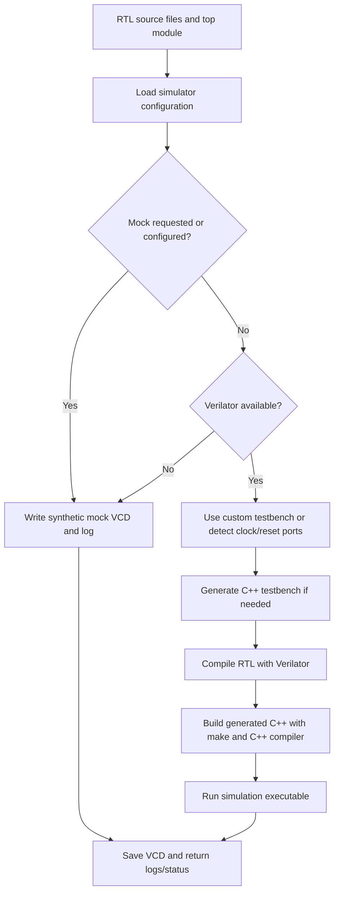

# AI-Powered RTL Code Understanding & Bug Detection Platform

A Python command-line tool for compiling and simulating Verilog/SystemVerilog RTL, with automatic clock/reset input detection and VCD waveform output. It can use Verilator for real builds or a mock mode for lightweight workflow checks.

> **Current scope:** The implementation currently provides RTL compile/simulation orchestration and synthetic mock waveforms. AI-based RTL understanding, bug detection, waveform analysis, and report generation are not yet implemented; the related configuration entries are placeholders for future work. Mock mode does not simulate the supplied RTL.

## Features

- CLI commands to compile and simulate RTL modules.
- Verilator integration for real RTL builds and simulations.
- Automatic clock and reset name detection for generated C++ testbenches.
- Optional custom C++ testbench support.
- VCD waveform output in `sim_build/` by default.
- Mock fallback when Verilator is unavailable, useful for checking the orchestration and output format.
- YAML-based simulator configuration and structured console logging.

## Workflow



## Requirements

- Python 3.12 or newer.
- For real Verilator simulation: Verilator, `make`, and a compatible C++ compiler available on `PATH`.
- Without Verilator, the application falls back to mock mode unless mock is explicitly selected.

## Installation

Create and activate a virtual environment, then install the project and development dependencies:

```powershell
py -3.12 -m venv .venv
.\.venv\Scripts\Activate.ps1
python -m pip install --upgrade pip
python -m pip install -e ".[dev]"
```

On systems where PowerShell script activation is restricted, use the appropriate activation command for your shell or invoke `.venv`'s Python directly.

## Usage

Compile the example counter module:

```powershell
rtlverify compile examples/counter/counter.v --top counter
```

Run a simulation and generate a waveform:

```powershell
rtlverify simulate examples/counter/counter.v --top counter --max-time 1000
```

Force mock mode (creates a synthetic VCD; it does not execute the RTL design):

```powershell
rtlverify simulate examples/counter/counter.v --top counter --mock
```

Provide a custom C++ testbench:

```powershell
rtlverify simulate path/to/design.v --top design --tb path/to/testbench.cpp --max-time 1000
```

Enable verbose logging by adding `--verbose` or `-v` before the command:

```powershell
rtlverify --verbose simulate examples/counter/counter.v --top counter
```

The simulator writes the configured VCD file to `sim_build/waveform.vcd` by default. Verilator build files and generated testbench sources are also placed under `sim_build/`.

## Configuration

Edit `configs/default_config.yaml` to change the simulator settings. Current simulator keys include:

| Key | Default | Description |
| --- | --- | --- |
| `simulator.default_engine` | `verilator` | Select `verilator` or `mock`. |
| `simulator.verilator_path` | `verilator` | Verilator executable name or path. |
| `simulator.cxx_compiler` | `g++` | Configured C++ compiler name. |
| `simulator.output_dir` | `sim_build` | Directory for generated files. |
| `simulator.vcd_filename` | `waveform.vcd` | Output waveform filename. |

The YAML also contains `ai`, `analysis`, `database`, and `reports` settings for possible future capabilities. These settings are not currently connected to implemented AI analysis or report-generation workflows. Do not put API keys or other secrets in committed configuration files.

## Development and tests

Install the development extras and run the test suite:

```powershell
python -m pip install -e ".[dev]"
pytest
```

The tests cover configuration loading, clock/reset name detection, mock waveform creation, and the real-or-fallback simulation workflow.

## Project layout

```text
configs/                 Default YAML configuration
examples/counter/        Example Verilog counter
rtl_verify_platform/     CLI, configuration, logging, and simulation code
sim_build/               Generated simulator artifacts and VCD output
tests/                   Pytest suite
```

## License

No license file is currently included. Add a license before distributing or accepting contributions under an open-source license.
